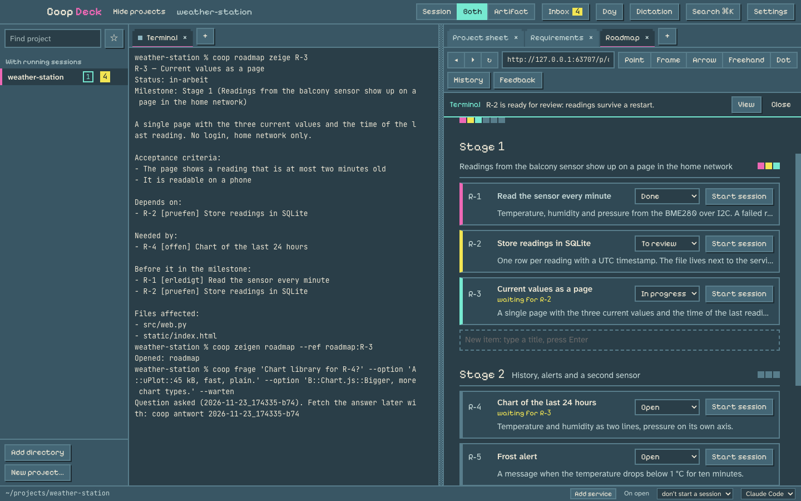

# Coop Deck

Arbeitsfläche für die Zusammenarbeit mit Coding-CLIs an Dingen, die länger halten als ein Chat. Links läuft die Session (Claude Code, Codex, opencode oder pi). Rechts steht das Artefakt, an dem ihr beide arbeitet: eine Roadmap, ein Projektblatt, ein Dokument, eine laufende Seite. Du zeigst, was du meinst, der Agent zeigt, was er meint, und was ihr entscheidet, bleibt als lesbare Datei im Projekt.



Das Bild zeigt ein Vorführprojekt in der englischen Oberfläche; ein gewöhnliches Terminal steht für eine CLI-Session. Weitere Bilder und die ausführliche Fassung stehen in [README.md](README.md).

English: [README.md](README.md). Sicherheit: [SECURITY.md](SECURITY.md). Mitmachen: [CONTRIBUTING.md](CONTRIBUTING.md).

## Die Idee

Die Arbeit mit einem Agenten im Terminal ist ein Gespräch, und Gespräche laufen aus dem Bild. Der Plan von heute Morgen, die drei Entscheidungen von gestern und die Liste des Offenen stehen in einem Verlauf, den die nächste Session nicht sieht und den ein anderes Werkzeug nicht lesen kann.

Das Deck hält diese Dinge als **Artefakte**: lesbare Dateien im Projekt unter `.coop/`, jede mit einer Ansicht neben der Session.

- **Sie überdauern die Session.** Eine neue Session beginnt mit einem Briefing, das Projektblatt, Artefakte und die letzte Übergabe nennt.
- **Sie hängen an keinem Werkzeug.** Einen Roadmap-Punkt heute mit Claude Code beginnen und morgen mit Codex fortsetzen: beide lesen und schreiben dieselben Dateien über denselben kleinen Befehl.
- **Zeigen statt beschreiben.** Eine Stelle in der Ansicht markieren und einen Satz dazu sagen. Die Session bekommt einen Text, der nennt, was gemeint ist, wo, und was du dazu sagst.
- **Der Agent meldet sich.** Mit dem Befehl `coop` (oder denselben Funktionen als MCP-Tools) öffnet er ein Artefakt an einer Stelle, setzt einen Hinweis, stellt eine Frage mit Optionen oder schreibt die Roadmap fort. Was auf dich wartet, steht in einem Eingang über alle Projekte.
- **Alles ist Datei.** Keine Datenbank, kein Konto. Artefakte lassen sich lesen, vergleichen und versionieren wie der Rest des Projekts.

## Coop Deck und cipher-mux

Das Deck hat ein Geschwister: [cipher-mux](https://github.com/cmarkus42-rgb/cipher-mux-electron), ein Cockpit, das viele Agenten-Sessions nebeneinander in einem Raster führt, mit Rollen, Entwicklungsprozess und Sprache.

| | cipher-mux | Coop Deck |
|---|---|---|
| Frage | Wie führe und koordiniere ich viele Sessions? | Wie arbeiten ein Agent und ich an derselben Sache? |
| Im Fenster | Raster mit bis zu 21 Sessions | Eine Session neben einem Artefakt |
| Schwerpunkt | Sessions, Rollen, Prozess | Artefakte, die als Dateien im Projekt bleiben |
| Richtung | Du beauftragst, Agenten arbeiten parallel | Beide Seiten zeigen, fragen und antworten |

Das Deck ist eine neue Codebasis, kein Fork. Aus cipher-mux stammen der Parser für den tmux-Control-Mode und die Erfahrung mit dem Tippen in ein pty. Die beiden hängen nicht voneinander ab und lassen sich nebeneinander benutzen.

## Stand

Version 0.0.1, gebaut und täglich benutzt von einer Person. Entwickelt unter macOS; unter Linux laufen die Kerntests in der CI, das Fenster selbst ist dort noch nicht von Hand ausprobiert. Die App ist nicht mit einer Entwickler-Kennung signiert, einen Download gibt es noch nicht: gebaut wird aus dem Quelltext.

## Starten

```bash
export PATH="/opt/homebrew/opt/node@22/bin:$PATH"   # nur wenn Node 22 über Homebrew neben einem anderen Node liegt
npm install        # einmal
npm start          # baut und öffnet das Fenster
npm test           # Kerntests, braucht tmux
npm run typecheck
```

Voraussetzungen: macOS oder Linux, Node 22, tmux, mindestens eine der vier CLIs im Pfad. Entwickelt wird unter macOS. Unter Linux laufen die Kerntests in der CI; das Fenster selbst ist dort noch nicht von Hand erprobt. Windows nur über WSL, dort ist das Deck ein Linux-Programm. Unter Linux liegt der Laufzeitzustand in `$XDG_DATA_HOME/coop-deck/` (sonst `~/.local/share/coop-deck/`), die Befehlstaste ist Strg+Umschalt statt ⌘ (Strg+Umschalt+K, Strg+Umschalt+D, Strg+Alt+1–3), und `npm run app:linux` baut ein AppImage.

Als App:

```bash
npm run app        # baut release/mac-arm64/Coop Deck.app (ad hoc signiert)
npm run dmg        # Abbild zum Weitergeben
npm run symbol     # zeichnet das App-Symbol neu (scripts/symbol.mjs)
```

Die App bringt ihr eigenes Node mit; der Befehl `coop` läuft darüber. Sie ist nicht mit einer Entwickler-Kennung signiert: Auf einem fremden Mac öffnet man sie beim ersten Mal über Rechtsklick → Öffnen.

Beim ersten Start kennt das Deck kein Projekt. „Verzeichnis hinzufügen“ nimmt ein einzelnes Projekt auf; in den Einstellungen nennt man die Ordner, in denen Projekte liegen.

## Wo was liegt

| Ort | Inhalt |
|---|---|
| `<projekt>/.coop/` | Artefakte, Rückmeldungen, Hinweise, Fragen eines Projekts. Lesbare Dateien, mit git versionierbar. |
| `~/Library/Application Support/coop-deck/` (Linux: `~/.local/share/coop-deck/`) | Laufzeit: Projektregister, Sitzungsregister, Briefings je Session (`runs/`), der Befehl `coop` (`bin/`). Außerhalb synchronisierter Ordner. |
| `src/core/` | Kern ohne Electron: Projekte, Sessions (tmux), Protokoll, Roadmap, lokaler Server. |
| `src/shell/` | Electron-Hülle und die Markier-Ebene, die in jeder Ansicht läuft. |
| `src/ui/` | Oberfläche (Preact, xterm.js). |
| `src/cli/` | Der Befehl `coop`. |
| `mobil/` | Die Seite fürs Handy, ausgeliefert von einem eigenen kleinen Server (`src/core/mobil.ts`). |
| `typen/` | Typbibliothek der Artefakte: je Typ Vorlage, Darstellung und Kurzanleitung für Agenten (`AGENT.md`). |

## Der Befehl coop

In jeder Session des Decks im Pfad. `coop hilfe` zeigt alles; die wichtigsten:

```
coop zeigen <artefakt|datei|adresse> [--ref <bezug>]
coop hinweis "<text>" [--artefakt <id>] [--ref <bezug>]
coop frage "<titel>" --option "A::Titel::Erläuterung" … [--warten]
coop bild <artefakt|adresse>
coop melden "<ein, zwei Sätze>"
coop anfordern "<was du brauchst>" [--art foto|ton|beides] [--warten]
coop roadmap liste | zeige R-3 | status R-3 in-arbeit --notiz "…" | neu "<titel>"
coop rueckmeldung erledigt <kennung> --notiz "…"
```

Dieselben Funktionen gibt es als MCP-Server (`coop mcp`, Tools mit dem Präfix `coop_`). Das Deck gibt ihn Claude Code, Codex und opencode beim Start mit, ohne deren Konfiguration anzufassen.

Außerhalb einer Deck-Session wirkt `coop` auf das Projekt in `COOP_PROJEKT` oder auf das nächste Verzeichnis mit `.coop/` oberhalb des Arbeitsverzeichnisses.

## Einen Artefakttyp ergänzen

Ein Ordner unter `typen/<name>/` mit `typ.json` (Name, Zweck), `index.html` samt Skript, `vorlage.json` und `AGENT.md`. Die Seite bindet `/lib/basis.css` und `/lib/coop.js` ein, liest ihre Daten mit `coop.laden()` und schreibt mit `coop.aendern(fn)`. Inhalte, auf die man zeigen können soll, tragen `data-coop-ref` und `data-coop-label`.

## Lizenz

MIT, siehe `LICENSE`. Mitgelieferte Fremdsoftware und Schriften: `NOTICE`.

## Herkunft

Der tmux-Parser (`src/core/tmux/parser.ts`) stammt aus cipher-mux-electron, ebenso die Erfahrungswerte zum Eintippen in ein pty. Das Muster aus Markieren, Senden, Zeigen und Abfragen stammt aus dem CAD-Cockpit.
