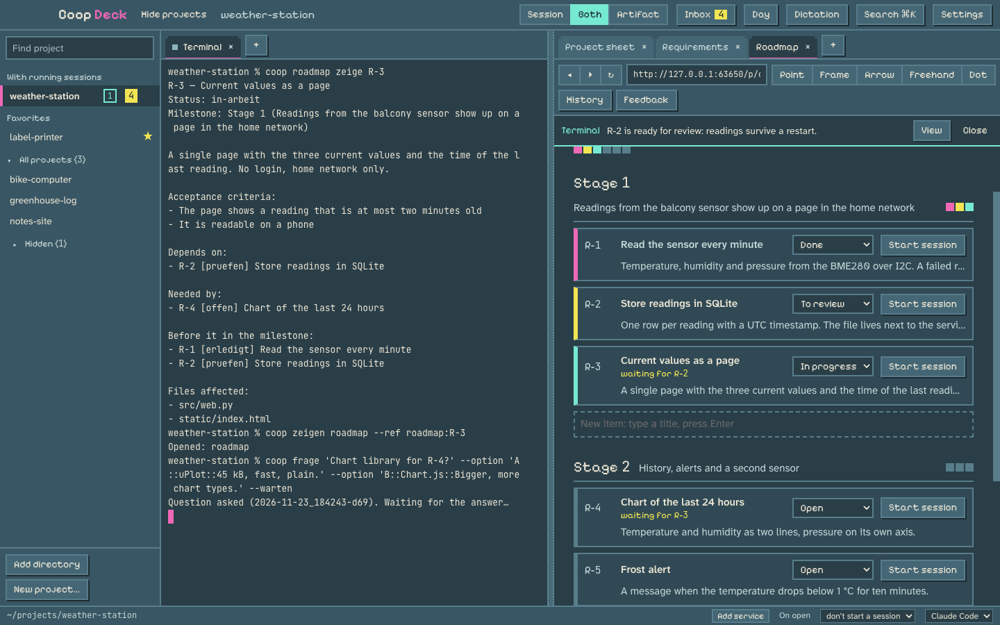
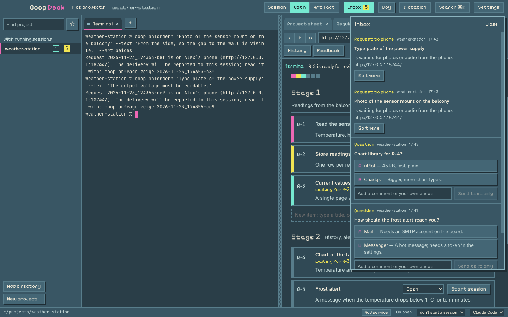
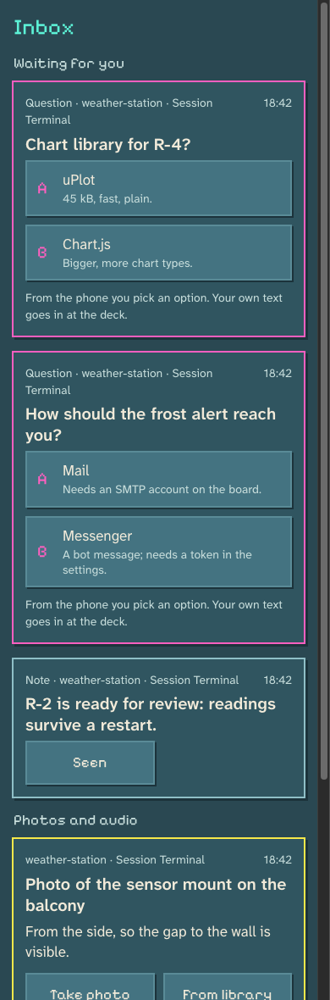

# Coop Deck

A workspace for working with coding CLIs on things that last longer than one chat. The session runs on the left (Claude Code, Codex, opencode or pi). On the right sits the artifact you are both working on: a roadmap, a project sheet, a document, a running page. You point at what you mean, the agent shows you what it means, and what you decide together stays in the project as plain files.



Deutsch: [README.de.md](README.de.md). The interface is available in German and English; commands and the identifiers in the source are German.

## The idea

Working with an agent in a terminal is a conversation, and conversations scroll away. The plan from this morning, the three decisions from yesterday and the list of what is still open live in a chat history that the next session cannot see and that another tool cannot read.

The deck keeps these things as **artifacts**: readable files in the project under `.coop/`, each with a view next to the session.

- **They outlive the session.** A new session starts with a briefing that names the project sheet, the artifacts and the last handover. It picks up where the previous one stopped.
- **They are not tied to one tool.** Start an item of the roadmap with Claude Code today and with Codex tomorrow; both read and write the same files through the same small command. Use the CLI that fits the task or the one that has quota left.
- **You point instead of describing.** Mark a spot in the view and add a sentence. The session receives a text that says what is meant, where, and what you said about it. A picture is attached, but the text alone is enough.
- **The agent can talk back.** With the command `coop` (or the same functions as MCP tools) it opens an artifact at a certain spot, leaves a note, asks a question with options, or updates the roadmap. What waits for you is collected in one inbox across all projects.
- **Everything is a file.** No database and no account. Artifacts can be read, diffed and committed like the rest of the project, and an agent without the command can still take part by reading and writing them.

| Inbox across projects | Page for the phone |
|---|---|
|  |  |

The screenshots show a demo project, with a plain terminal standing in for a CLI session.

## What is in it

- **Sessions** run in tmux on their own server, so they survive closing the window. Each session gets a briefing with the project sheet, the artifacts of the project and the rules for working together. The CLIs report by themselves whether they are working, done or waiting for approval; for pi this is the least tested.
- **Artifact types**: roadmap, project sheet, questionnaire, variant selection, review, handover, document. Typed artifacts separate data from presentation, so the agent edits a small JSON or Markdown file and never the view. Free HTML pages and local services of a project (a dev server, a viewer) sit next to them as tabs. A project can offer one of its services to all projects; once you confirm it, every session learns about it in its briefing.
- **Roadmap with sessions**: every item has an ID that never changes, acceptance criteria and a status. A session can be started on an item and gets that item in its briefing.
- **Feedback** with numbered marks on any view, sent to a session as readable text; a history per artifact with before and after.
- **Inbox** across all projects: sessions that are done or need approval, open questions, notes.
- **From the phone**: a session asks for photos or a spoken note with `coop anfordern`; you deliver from a page on your phone and the session gets the file paths, with speech transcribed locally. The same page shows the inbox and lets you answer a question by picking an option. Off by default.
- **Reports where you are**: with `coop melden` a session that has waited for a build or a test run tells you through a Telegram bot you set up, or as a notification on the computer.
- **Voice**: dictation with local speech recognition, reading notes aloud with the system voice or a Piper voice of your own, an optional Bluetooth remote.
- **Search and command palette**, project templates, import of a finished HTML page as an artifact.

Nothing is sent to a server of this project. If you set up a Telegram bot, the messages your sessions report go to Telegram. Speech recognition and speech output use programs installed on your machine.

## Coop Deck and cipher-mux

The deck has a sibling: [cipher-mux](https://github.com/cmarkus42-rgb/cipher-mux-electron), a cockpit that runs many agent sessions side by side in a grid, with roles, a development process and voice. The two answer different questions.

| | cipher-mux | Coop Deck |
|---|---|---|
| Question | How do I run and coordinate many agent sessions? | How do an agent and I work on the same thing? |
| On screen | A grid of up to 21 sessions | One session next to one artifact |
| Centre of gravity | Sessions, roles, process | Artifacts that persist as files in the project |
| Direction | You instruct, agents work in parallel | Both sides point, ask and answer |
| CLIs | Claude Code first; Codex CLI and opencode alongside | Claude Code, Codex, opencode and pi; each gets the briefing and the back channel |

The deck is a new code base, not a fork. It takes the tmux control-mode parser and the experience with typing into a pty from cipher-mux. If you want to orchestrate, look at cipher-mux; if you want to sit next to one agent and look at the same roadmap, this is the place. They do not depend on each other and can be used side by side.

## Status

Version 0.0.2, built and used daily by one person. It works for that person's projects; expect rough edges elsewhere.

- Developed on macOS. On Linux the core tests run in CI, but the window itself has not been tried by hand there yet. Windows only through WSL.
- The app is not signed with a developer ID. There is no download yet; you build it from source.
- Commands, file formats and status values are German words in both interface languages (`coop zeigen`, `in-arbeit`). `coop hilfe` and the briefing explain them.
- Issues and pull requests are welcome in English or German. See [CONTRIBUTING.md](CONTRIBUTING.md).

## Requirements

macOS or Linux, Node 22, tmux, and at least one of the four CLIs on your path. Optional: `whisper-cli` and `ffmpeg` for dictation; for speech output `say` (macOS) or `espeak-ng` (Linux), or a Piper voice of your own (`piper` plus an `.onnx` model, set in the settings).

| | macOS | Linux |
|---|---|---|
| Runtime state | `~/Library/Application Support/coop-deck/` | `$XDG_DATA_HOME/coop-deck/`, by default `~/.local/share/coop-deck/` |
| Command key | ⌘ (⌘K, ⌘⇧D, ⌘⌥1–3) | Ctrl+Shift (Ctrl+Shift+K, Ctrl+Shift+D), Ctrl+Alt+1–3. Ctrl alone stays with the terminal. |
| App bundle | `npm run app` | `npm run app:linux` (AppImage) |

## Run

```bash
npm install        # once
npm start          # builds and opens the window
npm test           # core tests, needs tmux
npm run typecheck
```

As an app:

```bash
npm run app        # builds release/mac-arm64/Coop Deck.app (ad hoc signed)
npm run dmg        # disk image
```

The app is not signed with a developer ID. On another Mac, open it the first time with right-click → Open.

On first start the deck knows no project. Add a single directory, or list the folders that contain your projects in the settings. The deck opens projects in place and copies nothing.

## How to use it

The guide is built into the deck: the button **Guide** at the top right opens it as a tab next to your session, in the language of the interface. The same chapters are here: [guide in English](docs/anleitung/en/README.md), [Anleitung auf Deutsch](docs/anleitung/de/README.md).

Both come from one source (`anleitung/`). Names of buttons and the command list are filled in from the texts of the interface, and a test fails when the interface gains something the guide does not mention.

## Where things live

| Place | Content |
|---|---|
| `<project>/.coop/` | Artifacts, feedback, notes and questions of a project. Readable files, versionable with git. |
| `~/Library/Application Support/coop-deck/` (Linux: `~/.local/share/coop-deck/`) | Runtime state: project and session registers, briefings per session, the `coop` command. |
| `src/core/` | The core without Electron: projects, sessions (tmux), protocol, roadmap, local server. |
| `src/shell/` | The Electron shell and the marking layer that runs in every view. |
| `src/ui/` | The interface (Preact, xterm.js). |
| `src/cli/` | The `coop` command and the MCP server. |
| `mobil/` | The page for the phone, served by its own small server (`src/core/mobil.ts`). |
| `typen/` | The type library: per type a template, a view and a short guide for agents (`AGENT.md`). |

## The coop command

On the path in every session of the deck. `coop hilfe` lists everything; the most important ones:

```
coop zeigen <artifact|file|url> [--ref <reference>]
coop hinweis "<text>" [--artefakt <id>] [--ref <reference>]
coop frage "<title>" --option "A::Title::Explanation" … [--warten]
coop bild <artifact|url>
coop melden "<one or two sentences>"
coop dienst liste | starte <name>
coop anfordern "<what you need>" [--art foto|ton|beides] [--warten]
coop roadmap liste | zeige R-3 | status R-3 in-arbeit --notiz "…" | neu "<title>"
coop uebergabe "<state>" --offen "…" --naechster "…"
coop rueckmeldung erledigt <id> --notiz "…"
```

The same functions exist as an MCP server (`coop mcp`). The deck hands it to Claude Code, Codex and opencode at start without touching their configuration.

## Adding an artifact type

A folder `typen/<name>/` with `typ.json` (name, purpose), `index.html` plus script, `vorlage.json` and `AGENT.md`. The page includes `/lib/basis.css` and `/lib/coop.js`, reads its data with `coop.laden()` and writes with `coop.aendern(fn)`. Content you should be able to point at carries `data-coop-ref` and `data-coop-label`.

## Security

Content from a project counts as foreign: free artifacts and project files are served sandboxed and cannot reach the interface of the deck. Nothing a page sends is typed verbatim into a session. Details and how to report a problem: [SECURITY.md](SECURITY.md).

## License

MIT, see `LICENSE`. Bundled third-party software and fonts: `NOTICE`.

## Origin

The tmux parser (`src/core/tmux/parser.ts`) comes from [cipher-mux](https://github.com/cmarkus42-rgb/cipher-mux-electron), as do the empirical values for typing into a pty. The idea of pointing at something instead of describing it comes from a small viewer for CAD work, where pointing at a part turned out to be faster than naming it.
